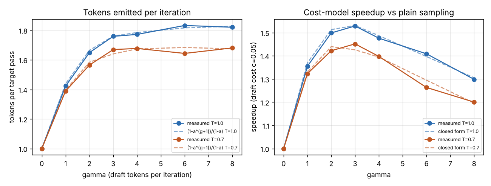

# ai-speculative-decoding

Speculative sampling built from scratch in NumPy, plus an exact enumerator that
proves it changes nothing about the output distribution.

A small, cheap **draft** model proposes `gamma` tokens. The expensive **target**
model scores all of them in one batched forward pass. Each draft token `x` is
accepted with probability `min(1, p(x)/q(x))`. On the first rejection a
replacement is drawn from the residual `max(0, p − q)` (normalised) and the
iteration ends; if every draft survives, a bonus token comes from `p`. Every
emitted token is distributed exactly as if the target had sampled it alone:

```
P(emit x) = q(x)·min(1, p(x)/q(x)) + (1 − α)·r(x) = min(p, q)(x) + max(0, p − q)(x) = p(x)
α = Σ_x min(p(x), q(x)) = 1 − TV(p, q)
```

What you get is fewer target forward passes for the same output distribution.
The method is from Leviathan, Kalman & Matias (2023) and Chen et al. (2023).

## What's here

| File | Contents |
|---|---|
| `specdec/models.py` | Procedural sentence grammar (no download needed), char vocab, Jelinek-Mercer interpolated n-gram LM with call counting and a batched `dist_batch` that counts as one forward pass |
| `specdec/speculative.py` | Temperature/greedy transform, residual distribution, `speculative_step`, `speculative_generate`, plain `autoregressive_generate`, per-run statistics (acceptance, α, tokens per pass) |
| `specdec/theory.py` | Closed forms (α, expected tokens `(1−α^{γ+1})/(1−α)`, chunk-length pmf, wall-time improvement, optimal γ) and an **exact enumerator** of the whole speculative process |
| `demo.py` | Trains a 5-gram target and weaker drafts, sweeps γ, temperature and draft quality, and checks greedy equivalence |
| `tests/test_specdec.py` | 30 tests |

## How it's verified

The expected values in the tests come from somewhere other than the
implementation:

- **Hand arithmetic.** With `p = [.5,.3,.2]` and `q = [.2,.2,.6]`: α = 0.6, TV = 0.4,
  residual `[.75,.25,0]`, and the exact one-step chunk law (`P((0,)) = 0.3`,
  `P((x,y)) = 0.2·p_y`, …).
- **Exact equality of whole sequences.** `exact_sequence_distribution` enumerates
  every draft path, every accept/reject outcome and every residual draw. It is
  checked against the target's own autoregressive law over all length-4
  sequences, using a 2nd-order Markov target, a 1st-order draft (both with
  zero-probability tokens), γ ∈ {0,1,2,3,5} and T ∈ {1.0, 0.6}. The max
  absolute error is **< 1e-12**.
- **Closed forms.** The expected chunk length from exact enumeration equals
  `(1−α^{γ+1})/(1−α)` to 1e-12 for context-free models. A Monte Carlo histogram
  of 40,000 chunk lengths matches the truncated-geometric pmf within 5 SE.
- **Monte Carlo on the trained models.** The joint law of the first two sampled
  characters after `"the "` matches the target's exact law within 5 SE
  (30,000 draws).
- **Greedy.** At T = 0, speculative output is token-for-token identical to greedy
  target decoding for γ ∈ {1,3,6}, and it uses fewer target passes.
- **Mutation check (run once by hand, not part of the suite).** Four
  deliberately broken variants were each caught by 2–12 failing tests:
  sampling the replacement from `p` instead of the residual, using
  `u < p(x)` as the acceptance rule, drawing the bonus token from the draft,
  and breaking the residual.

## Run it

```bash
pip install -r requirements.txt     # numpy, pytest; matplotlib only for --plot
python3 -m pytest -q tests
python3 demo.py --plot
```

Python 3.13.16, NumPy 2.5.3, pytest 9.1.1 on Linux: **30 passed in 7.3 s**.

## Sample output (real run of `python3 demo.py --plot`)

```
vocab: 27 chars    held-out: 11180 chars
held-out perplexity  target (5-gram): 1.935   draft (bigram): 7.666

sample (gamma=4, T=1.0):
  the clever robot always runs. ever watchilgfollows a cat with thisloriver this river drave garden. a sailor s a rinks near the fathes this red chine red painter machis lazy stud
  98 target passes for 160 chars (1.63 chars per pass)

temperature 1.0   (cost model: draft pass = 0.05 target pass)
 gamma  accept  mean_alpha  tok/iter  pred(alpha)  target_calls  speedup  pred_speedup
     0       -           -     1.000        1.000          4000    1.00x         1.00x
     1   0.423       0.438     1.423        1.438          2811    1.36x         1.37x
     2   0.454       0.456     1.649        1.665          2426    1.50x         1.51x
     3   0.459       0.457     1.759        1.761          2275    1.53x         1.53x
     4   0.448       0.450     1.772        1.784          2258    1.48x         1.49x
     6   0.459       0.451     1.832        1.816          2184    1.41x         1.40x
     8   0.452       0.453     1.820        1.827          2200    1.30x         1.31x

temperature 0.7   (cost model: draft pass = 0.05 target pass)
 gamma  accept  mean_alpha  tok/iter  pred(alpha)  target_calls  speedup  pred_speedup
     0       -           -     1.000        1.000          4000    1.00x         1.00x
     1   0.389       0.396     1.389        1.396          2879    1.32x         1.33x
     2   0.403       0.413     1.565        1.584          2557    1.42x         1.44x
     3   0.419       0.407     1.669        1.640          2396    1.45x         1.43x
     4   0.411       0.410     1.677        1.674          2385    1.40x         1.40x
     6   0.392       0.407     1.644        1.684          2435    1.26x         1.30x
     8   0.405       0.403     1.681        1.675          2380    1.20x         1.20x

draft quality vs acceptance (gamma=4, T=1.0):
 draft          held-out ppl  mean_alpha  tok/iter  target_calls  speedup
 1-gram              18.046       0.273     1.365          2931    1.14x
 2-gram               7.666       0.449     1.785          2242    1.49x
 3-gram               3.369       0.711     2.842          1408    2.37x
 4-gram               2.298       0.897     4.015           997    3.34x

greedy (T=0), 400 chars, gamma=6:
  identical to target-only greedy decode: True
  target passes: 400 autoregressive vs 251 speculative  (acceptance 0.372)

closed-form optimal gamma at c = 0.05:
  alpha=0.30->2  alpha=0.50->3  alpha=0.70->6  alpha=0.80->8  alpha=0.90->13  alpha=0.95->21

wrote output/gamma_sweep.png
```



### Reading the results

- **The closed form predicts the measured speedup to within about 0.02 tokens.**
  Plugging the measured mean α into `(1−α^{γ+1})/(1−α)` gives the measured
  tokens per pass. That holds even though α varies between contexts and the
  formula assumes it doesn't.
- **With a weak draft the best γ is small.** At α ≈ 0.45, the bonus from
  looking further ahead dies off after about three tokens, and the draft passes
  you pay for start to outweigh it. The speedup peaks at γ = 3 (1.53×), which
  matches the closed-form optimum.
- **Draft quality matters more than anything else.** With γ fixed at 4, moving
  from a bigram draft to a 4-gram draft raises α from 0.45 to 0.90. Target
  passes drop from 2242 to 997.
- **Low temperature does not raise acceptance here.** A lower temperature
  sharpens both p and q. Where they disagree on the argmax, the sharpened
  versions disagree harder, so α actually falls slightly at T = 0.7.
- **The sample text is ugly, and that's expected.** It is an unbiased draw from
  a smoothed char 5-gram at T = 1, and the tests prove the speculative sampler
  reproduces that law exactly. Better text would need a better target, not a
  different decoder.

## Scope and honesty notes

- The "speedup" column is a **cost model**: target pass = 1, draft pass = c = 0.05.
  It is not a wall-clock measurement. With n-gram models both passes are
  microseconds, so timing them would measure Python overhead and nothing else.
- `dist_batch` models a transformer scoring γ+1 positions in one forward pass.
  It counts as one call, which is the assumption that makes speculative
  decoding pay off on real hardware.
- CPU only, no API keys, no downloads. The corpus is generated by a seeded
  grammar, so every run and every test is deterministic.

## License

MIT
